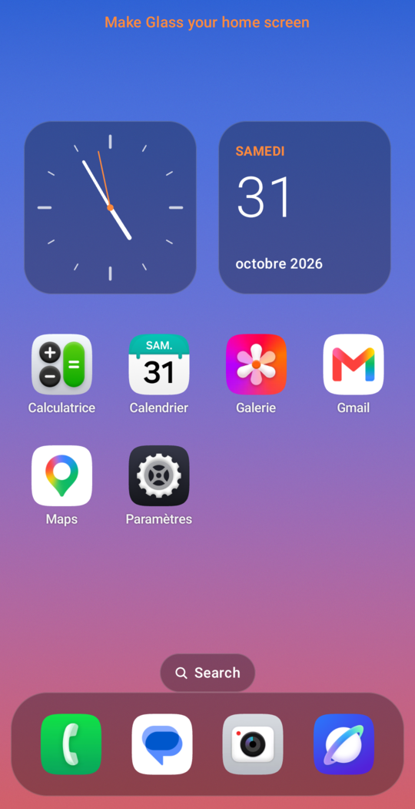
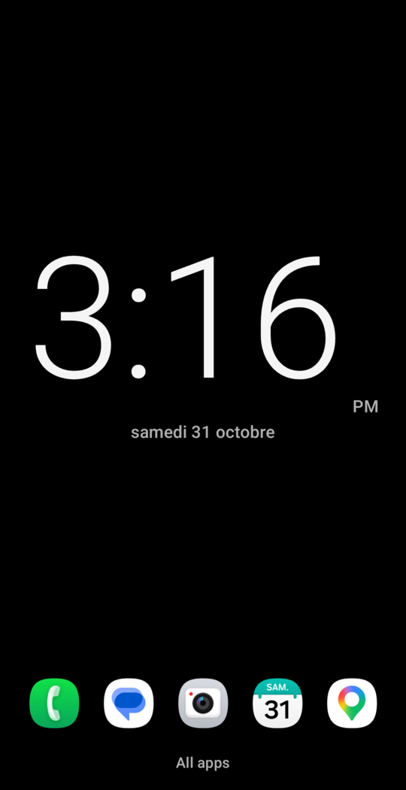
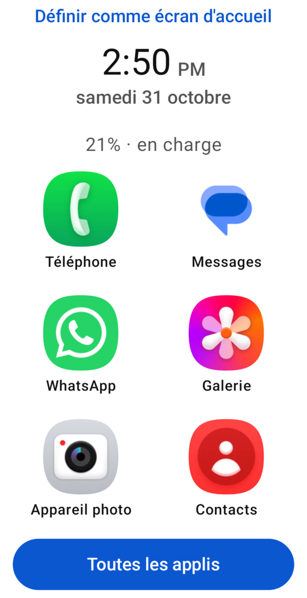
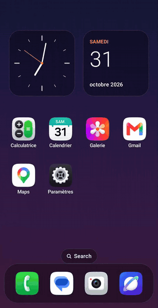

<p align="center"></p>

<h1 align="center">AI Launcher for Android</h1>

<p align="center"><strong>Describe your dream launcher. Your AI coding agent builds it and puts it on your phone.</strong></p>

An open-source Android home screen made to be changed by an AI agent. Say what you want in plain words, and your agent
edits the code, installs it on your phone, checks that it runs, and looks at the result.

> *"Make this a black minimalist launcher with 5 apps, a big clock and a focus timer."*

<table>
  <tr>
    <td align="center"><a href="gallery/glass/"></a><br><b>Glass</b></td>
    <td align="center"><a href="gallery/minimal/"></a><br><b>Minimal</b></td>
    <td align="center"><a href="gallery/seniors/"></a><br><b>Seniors</b></td>
    <td align="center"><a href="gallery/focus/"></a><br><b>Focus</b></td>
  </tr>
</table>

These are real screenshots of launchers that Claude Code built on a real phone from a short request. The
[gallery](gallery/) has the prompt behind each one.

<p align="center"></p>
<p align="center"><em>The glass style on a real phone: the long-press menu, dragging an icon, app groups and search.</em></p>

**Contents:** [Why this project](#why-this-project) · [Quick start](#quick-start) ·
[What to ask for](#what-to-ask-for) · [How it works](#how-it-works) · [What's included](#whats-included) ·
[Use it without an agent](#use-it-without-an-agent) · [Safety](#safety) · [Going back](#going-back-to-your-old-launcher) ·
[Troubleshooting](#troubleshooting) · [What's been tested](#whats-been-tested) · [Contributing](#contributing)

## Why this project

Your home screen is the part of your phone you see most, but you can usually only change what its settings allow. A
launcher app gives you more options, but they're still someone else's options. Building your own has meant learning
Android development.

AI coding agents change that, but pointing one at an empty folder is a gamble. It has to set up an Android project from
nothing, and it can't easily tell whether the result works on your phone. This repo gives the agent what it needs:

- **A launcher that already works,** so the agent changes something good instead of starting from nothing.
- **A way to check its own work.** One command installs the launcher, looks for crashes and takes screenshots for the
  agent to look at, so it can find and fix problems without asking you.
- **Clear instructions and limits.** [`AGENTS.md`](AGENTS.md) tells the agent where to make changes and what to ask you
  first, such as before installing tools or adding permissions.
- **A way out.** If a change makes the launcher keep crashing, a basic safe mode opens, so you aren't left without a home
  screen.

It's useful if you want:

- **A calmer phone,** with fewer apps and fewer distractions.
- **A simple phone for a parent or relative,** with big buttons and only the apps they use.
- **A home screen that looks like nothing else,** or a feature no launcher has, such as hiding social apps during work.
- **A real Android project to learn from,** with an agent to explain and change it as you watch.

## Quick start

### What you need

- A computer with a terminal. It's been tested on Linux; the tools are bash scripts, so on Windows you'd need Git Bash or
  WSL.
- An Android phone, version 8.0 or newer, on the same Wi-Fi as your computer or connected by USB.
- A coding agent that can run commands, such as [Claude Code](https://claude.com/claude-code).

You don't need to install the Android tools first. The agent checks what's missing and asks before installing anything.

### 1. Turn on debugging on your phone

This lets your computer install the launcher.

1. Open **Settings > About phone** and tap **Build number** 7 times. On some phones, it's under **Software information**.
2. Go back to **Settings > Developer options**.
3. Choose how to connect:
   - **USB:** turn on **USB debugging**, plug in the phone, and accept the prompt that appears.
   - **Wi-Fi:** turn on **Wireless debugging** and choose **Pair device with pairing code**. Your agent will ask for the
     code it shows.

Turn debugging off again when you're finished. A launcher that's already installed keeps working without it.

### 2. Ask your agent

Open your agent in any folder and paste this, changing the last sentence to what you want:

> Clone github.com/MedTahiri/ai-launcher-android, read its AGENTS.md and follow it. Build me a launcher with big buttons and
> only my phone, messages and photos apps.

The agent then:

1. Checks your computer with `tools/doctor.sh`.
2. Changes the launcher to match your request.
3. Installs it and runs `tools/verify.sh`.
4. Looks at the screenshots, and fixes anything that's wrong.
5. Tells you what it built, and any way it falls short.

### 3. Make it your home screen

Installing the launcher doesn't replace your current one. When you're happy with it, open
**Settings > Apps > Default apps > Home app** and choose it. The exact path can differ between phones.

### 4. Keep changing it

Open your agent in the same folder and ask for more:

> Make the clock bigger, and hide my games until 6 pm.

## What to ask for

Plain words are enough. Say who it's for and what matters to you, and let the agent make the design choices.

| You could say | What it uses |
|---|---|
| *"A black screen with a huge clock and 5 apps."* | Settings in `launcher.json` |
| *"Big buttons for my mother, with only WhatsApp, Phone and Photos."* | Settings in `launcher.json` |
| *"Glass style with a warm orange accent."* | Settings in `launcher.json` |
| *"Hide social media until 6 pm."* | New code, with tests |
| *"Add a widget that shows a new quote each day."* | A new widget |
| *"Show the weather."* | A new widget, and the `INTERNET` permission, which the agent should ask you about first |

Not sure where to start? Point your agent at a [recipe](recipes/). Each one describes a kind of launcher:

| Recipe | Who it's for |
|---|---|
| [Minimal](recipes/minimal.md) | People who want a calm phone with almost nothing on the screen |
| [Seniors](recipes/seniors.md) | Older relatives, or anyone who finds phones hard to see and use |
| [Focus](recipes/focus.md) | People who want to stop opening distracting apps without thinking |
| [Glass](recipes/glass.md) | People who want a rich, good-looking home screen over their own wallpaper |

For example: *"Build the seniors recipe, with bigger text and my daughter's favorite apps."*

## How it works

```text
  You describe what you want
             │
             ▼
  Agent reads AGENTS.md and checks the computer (tools/doctor.sh)
             │
             ▼
  Agent makes the change, starting with the safest place:
  launcher.json → theme/ → home/ → widgets/ → core/ (last resort)
             │
             ▼
  tools/verify.sh runs the tests, builds and installs the launcher,
  opens it, looks for crashes, and takes screenshots  ◄──┐
             │                                           │
             ▼                                           │
  Agent looks at the screenshots ── something wrong? ────┘
             │
             ▼
  Agent tells you what it built
```

Automated checks can't see that text is invisible or a layout looks bad, so looking at the screenshots is a required
step. Testing this project showed why: the checks passed on a home screen whose clock was black on a black background,
and only a look at the screenshot caught it.

## What's included

### Two styles

Set with `home.style` in `launcher.json`.

| | `simple` (default) | `glass` |
|---|---|---|
| **Layout** | Widgets above a row of favorites | Swipeable pages of apps over your wallpaper |
| **Your main apps** | Favorites | A dock of up to 5 apps |
| **All apps** | An app drawer with search | A search screen and a page of app groups |
| **Long press** | App info and Uninstall | A menu that also adds apps to the dock and starts editing |
| **Arranging apps** | In `launcher.json` | Drag icons on the phone |

### One settings file

Many requests only need a change to [`launcher.json`](launcher.json):

```json
{
  "name": "Glass",
  "theme": { "mode": "dark", "background": "wallpaper", "accent": "#FF8A3D" },
  "home": {
    "style": "glass",
    "widgets": [{ "type": "analog_clock" }, { "type": "calendar" }],
    "favorites": ["com.android.chrome", "com.android.settings"]
  }
}
```

A misspelled setting or invalid value stops the build with a message saying what's wrong. [`AGENTS.md`](AGENTS.md) lists
every setting.

### Widgets

Digital clock, analog clock, calendar, battery and focus timer. A new widget takes one file and one line to register it.

### Tools

| Command | What it does |
|---|---|
| `tools/doctor.sh` | Checks the JDK, Android SDK, adb and connected devices, and gives the fix for each problem. Changes nothing |
| `./build.sh` | Checks `launcher.json`, runs the unit tests and builds the APK |
| `tools/verify.sh` | Builds, installs and opens the launcher on a device, looks for crashes, and saves screenshots to `.verify/` |
| `tools/check.sh` | Runs the checks that don't need a device: unit tests, build, permissions and recipe rules |
| `tools/apps.sh` | Lists the apps on the device, so an agent can find package names |

### Project layout

```text
launcher.json       The settings most changes need
AGENTS.md           The guide for AI agents, and the full list of settings
permissions.allow   The permissions the app may have
recipes/            Descriptions of kinds of launchers
gallery/            Real results, with the prompts behind them
tools/              The commands above
app/src/main/java/io/github/medtahiri/launcher/
  core/             Starting up, the app list, config and crash recovery
  theme/            Colors, fonts and shapes
  home/             The home screen and drawer
  home/glass/       The glass style
  widgets/          One file per widget
```

## Use it without an agent

You can build and customize it yourself. You need a JDK (17 or newer), the Android SDK with platform 37, and adb. Android
Studio includes all three.

```bash
git clone https://github.com/MedTahiri/ai-launcher-android
cd ai-launcher-android
tools/doctor.sh     # shows anything that's missing
```

Edit `launcher.json`, then connect your phone and run:

```bash
tools/verify.sh     # builds, installs and checks it
```

If more than one device is connected, choose one with `tools/verify.sh -s DEVICE`. `adb devices` lists them.

## Safety

- **Your current launcher stays installed.** This one only becomes your home screen if you choose it.
- **No internet by default.** The app has no `INTERNET` permission, and `tools/check.sh` fails if any permission appears
  that isn't in [`permissions.allow`](permissions.allow). Your agent is told to ask you before adding one.
- **Android asks before uninstalling.** Uninstall in the launcher only opens Android's own confirmation screen.
- **A way out of crashes.** If the launcher crashes 3 times within 5 minutes, a basic safe mode opens, with your apps and
  a button to switch launchers. It's built separately from the code that customizations change.
- **Your screenshots stay private.** Screenshots of your phone go in `.verify/`, which git ignores. The drawer screenshot
  shows the apps you have installed, so check before sharing one.

**Your agent runs code from this repo,** so read what you run, as with any project, and check what your agent is about to
do. Recipes are limited to design goals, and `tools/check.sh` rejects commands and links in them. Pull requests that
change recipes, tools or `AGENTS.md` are routed to the maintainer for review. All of this reduces the risk, but can't
remove it.

**Before publishing your own fork,** remember that `launcher.json` and any app rules contain package names that show what
you have installed.

## Going back to your old launcher

1. Open **Settings > Apps > Default apps > Home app** and choose your old launcher.
2. To remove this one, uninstall it like any app, or ask your agent to. You can also run:

```bash
adb uninstall io.github.medtahiri.launcher
```

## Troubleshooting

| Problem | What to do |
|---|---|
| `tools/doctor.sh` reports a problem | It prints the fix under each problem |
| "No device connected" | Check that debugging is on and the phone is unlocked. For USB, accept the prompt on the phone. For Wi-Fi, pair it again |
| "The phone is locked" | Unlock it and run the command again |
| The install fails with a signature error | A copy built on another computer is installed. Uninstalling it removes its settings, then you can install again |
| `launcher.json has a problem` | The message says which setting is wrong and what's allowed |
| A safe mode screen opened | The launcher kept crashing. Ask your agent to fix it, then press **Try the launcher again** |
| A favorite is missing | The app may not be installed, or package names may differ on your phone. `tools/apps.sh` lists the real ones |
| Text is in English on a phone in another language | Ask your agent to translate it. Dates already follow your phone's language |

## What's been tested

This is a young project, and this is what has actually been tried:

| | |
|---|---|
| **Agents** | Claude Code. Others should work through `AGENTS.md`, but are untested. |
| **Devices** | Samsung Galaxy A17 on Android 16. Others are untested, and older Android versions may have problems. |
| **Computers** | Linux. macOS and Windows are untested. |
| **Default home screen** | Tried by the maintainer on the Galaxy A17, with no problems reported. It hasn't had detailed testing, such as the Home button in each state. |
| **Not tested yet** | The app list updating after an install or removal; work profiles; large screens; emulators. |

Tried it on something else? Please [open an issue](https://github.com/MedTahiri/ai-launcher-android/issues) with what worked
and what didn't.

## Known limits

- No user-made folders, icon packs, Android widgets or notification dots yet.
- Only the `glass` style has drag and drop, and icons can't be dragged into or out of the dock.
- The focus timer makes no sound and sends no notification when it ends.
- The calendar widget shows the date only, not your events.
- The launcher's text is English until your agent translates it.
- The launcher is meant to be used in portrait on phones.
- There's no prebuilt APK: your agent builds it, since your launcher is meant to be your own.

## Contributing

- **Share your launcher:** add a screenshot and the prompt you used to the [gallery](gallery/). Its
  [README](gallery/README.md) explains what to include.
- **Report results:** an issue saying it worked or failed on your phone or agent is very useful.
- **Add a recipe:** see the [recipe rules](recipes/README.md).
- **Change the code:** run `tools/check.sh` before opening a pull request.

## License

[MIT](LICENSE)
