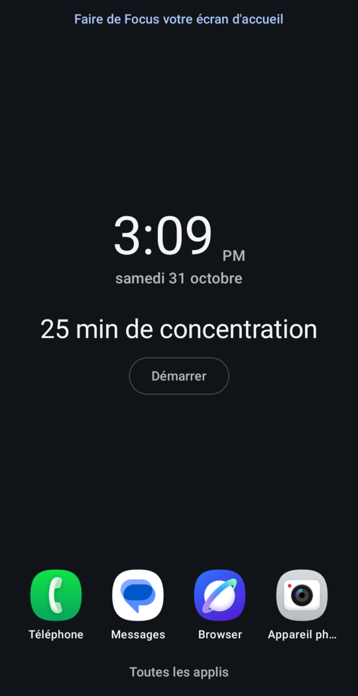

# Focus

- **Prompt:** "Build the focus recipe. Social media and games distract me: hide them until 6 pm."
- **Agent:** Claude Code, working from `AGENTS.md`, without a person involved.
- **Device:** Samsung Galaxy A17 set to French, Android 16. The screenshot is cropped to hide the status bar.
- **Fixed by hand:** nothing by a person. The agent wrote the time rule and its unit tests, and found an icon bug that's
  since been fixed in this repo.
